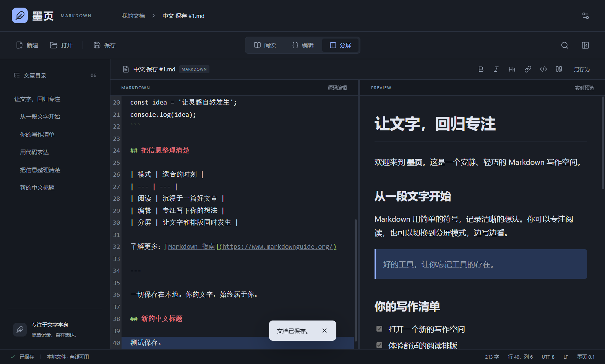

# 墨页 0.1.0 验收记录

验证日期：2026-11-20。首版功能与 Windows 交付产物已完成；以下明确区分自动化验证与仍需人工确认的项目。

## 环境与产物

- 系统：Windows 11 Home China，10.0.26200，x64。
- 硬件：Intel Core 5 220H，32 GiB 内存。
- 工具链：Node.js 22.21.0、Electron 45.4.1、TypeScript 5.9.3、electron-builder 26.18.0。
- 安装包：`release/Moyan-0.1.0-Setup.exe`。
- 免安装目录：`release/win-unpacked/`，启动其中的 `墨页.exe`；需保留同目录的依赖文件。
- 已检查独立程序版本资源：产品名“墨页”，应用版本 0.1.0，应用图标与元数据已写入。

## 已执行的检查

| 检查                       | 结果与范围                                                                             |
| -------------------------- | -------------------------------------------------------------------------------------- |
| TypeScript strict 类型检查 | 通过                                                                                   |
| ESLint                     | 通过                                                                                   |
| Prettier                   | 通过                                                                                   |
| Vitest                     | 15 项通过，覆盖文件往返、失败保护、版本保存、草稿、路径边界、渲染与两万行末尾完整性    |
| Electron 桌面端到端        | 4 项场景通过；生产构建与最终独立程序均已验证                                           |
| Windows 打包               | NSIS x64 安装包生成成功                                                                |
| 依赖审查                   | 升级 Electron、Vitest 并限定构建工具的 minimatch 修复版本后，npm audit 为 0 项已知漏洞 |
| 视觉检查                   | 已查看欢迎页、浅色分屏、深色分屏及最小窗口截图，无明显遮挡或布局溢出                   |

端到端场景使用真实 Electron 窗口、真实编辑器和临时测试文件。为了可重复运行，文件选择、另存为、未保存与冲突对话框的返回值在测试中被替换；文件读取、落盘、恢复和渲染使用实际实现。

## 已验证的关键行为

1. 示例中的标题、表格、代码和任务列表正常显示；目录更新，模式切换保留编辑内容与撤销历史。
2. 中文与空格路径可以真实保存，重新读取的内容正确；UTF-8 BOM、CRLF 和末尾换行能够往返保留。
3. 未保存时新建和关闭均可取消；外部修改后取消保存不改写磁盘，另存为保留外部版本。
4. 保存失败后编辑内容仍在，草稿能落盘；终止应用后重新启动，可以通过恢复界面取回内容。
5. 查找与替换全部可用，替换全部可以一次撤销；主题设置可切换，渲染进程无法直接访问 Node.js。
6. 断开浏览器网络后仍可打开本地 Markdown 和相对图片；目录外图片不能加载，失效图片显示占位。
7. Windows 目录联接不能绕过图片目录限制；原始 HTML、危险链接和脚本无法作为活动内容执行。
8. 最小 900 × 600 窗口保持主要操作可用；较大文档通过 Web Worker 在后台完成预览。

## 性能实测

以下使用最终 `release/win-unpacked/墨页.exe`，无开发服务器，并关闭测试窗口的网络。打开时间包含按钮触发、IPC 和文件加载；完整预览另计。每个文件重复打开三次，避免用上一份预览作为新文档的完成标记。

| 测量项                                   | 实测                                             |
| ---------------------------------------- | ------------------------------------------------ |
| 独立程序启动到欢迎页按钮可用             | 536 ms，单次；不代表严格的清空系统缓存冷启动测试 |
| 120,906 字节，约 2,000 行，界面可操作    | 57 / 51 / 38 ms                                  |
| 同一文件完整预览                         | 321 / 272 / 272 ms；中位数 272 ms                |
| 1,228,906 字节，约 20,000 行，界面可操作 | 46 / 56 / 60 ms                                  |
| 同一大文件完整预览                       | 8,720 / 8,878 / 8,525 ms；中位数 8,720 ms        |
| 两份文件输入到编辑器可见更新             | 分别 17 / 39 ms，单次自动化输入                  |

大文件样例为两万行没有空行分段的连续文本，形成极长 Markdown 段落。该样例完整预览尚未达到原先两秒目标；首版保持解析完整性，将排版放到后台，并显示“正在排版”。没有将这一限制表述为性能目标已全面达成。输入测量使用自动化文本插入，不替代原生中文输入法测试。

## 已知限制与待人工确认项

- 首版是单文档应用；公式、Mermaid、所见即所得、多标签、云同步和导出尚未包含。
- 超长连续段落的完整预览较慢，后台排版完成前目录与字数可能显示等待状态。
- 恢复以最近已写入的草稿为准，最后约两秒内容可能尚未落盘；草稿不会自动覆盖原文。
- 外部修改通过保存前内容校验检测；没有跨进程文件锁，检查与替换之间存在极短竞争窗口。
- 未实际执行安装器的安装、卸载与桌面快捷方式检查，避免在用户系统中注册应用；已对同一打包目录中的独立程序完成整套桌面测试。
- 尚需原生中文输入法候选词与组合过程、系统剪贴板复制、全程仅键盘操作、屏幕阅读器、不同系统缩放以及真实磁盘写满/文件锁定的人工验收。
- 自动化保存失败覆盖的是目录不存在的真实 I/O 错误；权限不足、磁盘空间不足、文件占用的错误分支已实现，但未逐项注入系统故障。

## 界面截图

