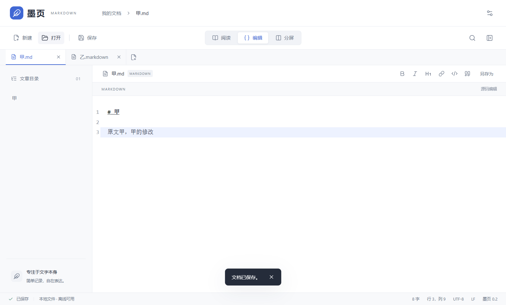
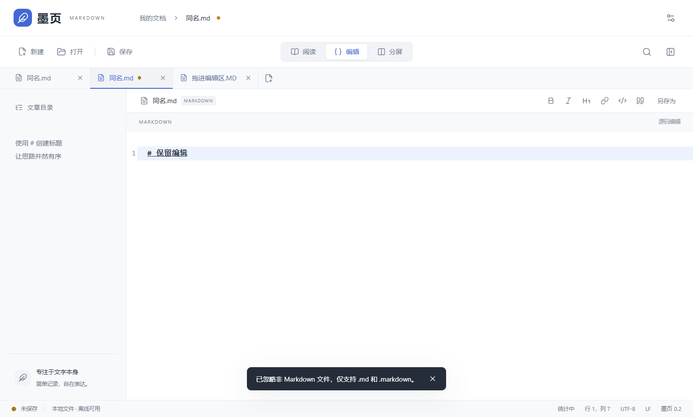

# 墨页 0.2.0 验收记录

更新日期：2026-11-21。此次变更对应多文件顶部标签、准确判断未保存内容和拖拽打开 Markdown 三项需求。0.1.0 的验证与初始性能数据保留在 [历史记录](验收记录-0.1.0.md)。

## 行为与实现

- 支持文件对话框多选和资源管理器拖入多个 `.md` / `.markdown` 文件，打开后在顶部标签切换、关闭。重复路径激活已有标签，同名不同目录分别保留，悬停可查看路径。
- 文件以文档标识分别管理；保存、关闭和相对图片读取均关联具体文档。另存为的目标如果属于其他已打开标签，会拒绝覆盖，保留两份内容。
- 未保存状态比较当前正文与最近实际落盘的正文；编辑版本只负责异步顺序。进入编辑模式、移动光标、查找和空白新建都不算修改；撤销或手动还原为保存内容后恢复干净状态。
- 只在关闭确有修改的标签或退出时询问保存。关闭后台标签只处理对应文件；退出中途取消时保留所有标签和未保存内容。
- 只创建一个 CodeMirror 视图，其他标签保留不可变编辑状态、撤销历史与滚动快照。活动标签生成预览，旧后台任务会终止；关闭标签会清理对应缓存。
- 多文件恢复草稿使用 schema 2，保存、还原或关闭一个标签不能删除其他标签草稿。可以读取 schema 1 的旧版单文档草稿；旧保存基准无法确认时保持待保存状态，避免误认为已保存。

## 验证

| 检查                             | 结果                                                          |
| -------------------------------- | ------------------------------------------------------------- |
| TypeScript strict                | 通过                                                          |
| ESLint                           | 通过，无警告                                                  |
| Prettier                         | 通过                                                          |
| 单元测试                         | 20 项通过                                                     |
| 生产构建桌面测试                 | 11 项通过                                                     |
| Windows 0.2.0 打包及独立程序测试 | NSIS x64 安装包生成成功；最终免安装程序 11 项桌面场景全部通过 |

单元测试新增覆盖：还原内容后的干净状态、保存过程中继续编辑或还原、同名文件与重复路径、按文档保存、多个草稿相互独立、旧版草稿迁移，以及禁止覆盖其他标签的文件。

桌面场景覆盖：

1. 原有阅读、分屏、编辑、撤销与实际保存。
2. 外部修改冲突、取消关闭与另存为。
3. 查找替换、保存失败后的内容保留、重启恢复、渲染进程隔离。
4. 离线相对图片、最小窗口和长文预览。
5. 多选文件、标签独立编辑与保存、切换后撤销重做。
6. 无修改、撤销、手动还原和空白新建后的静默关闭；干净工作区退出不询问，磁盘原文及 BOM / CRLF 不变。
7. 后台脏标签关闭、保存目标正确、退出中途取消后保留全部标签。
8. 通过 Chromium 原生拖拽事件传入真实文件路径，验证 File → 预加载层 → 主进程打开；覆盖多个文件、无效格式、重复文件、同名不同目录、拖入编辑区时保留其他修改。
9. 两份未保存草稿一起恢复，保存其中一份后仍保留另一份草稿。
10. 外部文件重新载入不产生重复标签，另存为不会覆盖另一已打开文件。
11. Ctrl+Tab / Ctrl+Shift+Tab 切换，保留光标、编辑器及阅读滚动位置，并可继续输入。

文件读写、编辑器、预览和拖拽使用实际实现。文件选择器与保存确认对话框在自动化中以固定返回值替代，以便可重复验证。

## 交付

- 当前版本：0.2.0。
- 安装包：`release/0.2.0/Moyan-0.2.0-Setup.exe`。
- 免安装程序：`release/0.2.0/win-unpacked/墨页.exe`，须保留整个目录；已检查版本资源为 0.2.0。
- 旧版产物保持原位置，未运行安装器或注册应用。
- 环境仍为 Windows 11 x64、Node.js 22、Electron 45.4.1；没有新增运行依赖。

## 已知限制

- 极长连续段落的首次完整预览仍需要数秒，排版在后台进行；已打开标签的再次激活会复用预览缓存。旧版冷打开的测量不能与当前复用缓存的切换耗时直接比较。
- 自动恢复以最近落盘的草稿为准，最后约两秒输入可能尚未写入。
- 尚未执行安装、卸载、原生中文输入法组合、系统剪贴板与屏幕阅读器的完整人工验收；文件锁定和磁盘写满仍是原有人工验证项。
- 仍无跨进程文件锁；保存前检查外部修改与替换之间存在极短竞争窗口。

## 界面

